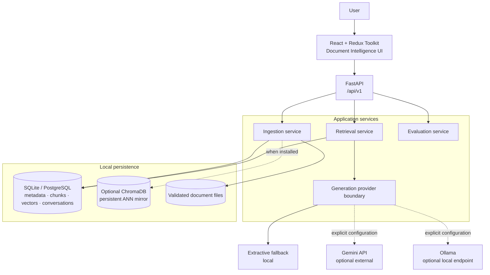
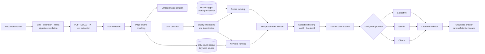

<div align="center">

# RAG DOCUMENT INTELLIGENCE

### Turn Documents Into Verifiable Knowledge.

A source-grounded document intelligence platform for ingestion, hybrid retrieval,
evidence inspection, and explicitly attributed answers.

<kbd>Python 3.11</kbd> · <kbd>FastAPI</kbd> · <kbd>SQLAlchemy</kbd> · <kbd>Hybrid Retrieval</kbd> · <kbd>ChromaDB</kbd> · <kbd>React</kbd> · <kbd>TypeScript</kbd>

[Overview](#overview) · [Architecture](#system-architecture) · [Pipeline](#rag-pipeline) · [Setup](#installation) · [API](#api-documentation) · [Verification](#testing-and-verification) · [Docs](#documentation)

</div>

> [!IMPORTANT]
> This repository is a production-oriented engineering study, not a production-readiness claim. The deterministic local path is tested; optional model providers, Docker runtime, PostgreSQL, and large-corpus performance remain explicitly unverified.

## Overview

RAG Document Intelligence converts PDF, DOCX, and text files into searchable knowledge with traceable evidence. It validates and extracts files, preserves page metadata, builds overlapping chunks, persists model-tagged embeddings, combines dense and lexical ranking, and returns answers with the exact passages used as evidence.

Unlike a basic PDF chatbot, retrieval is independently inspectable, generation providers are replaceable, citations are structured data, and insufficient evidence produces a refusal instead of a guessed answer.

## Problem and solution

Unstructured documents are difficult to search across, difficult to compare, and risky to use as AI context without attribution. Conventional keyword search misses semantic relationships; unconstrained generation can invent facts or citations.

This project addresses both problems:

- **Document intelligence:** secure ingestion, extraction, page-aware chunks, metadata, collections, summaries, and comparisons.
- **Verifiable retrieval:** dense similarity and keyword overlap are fused with Reciprocal Rank Fusion.
- **Grounded response:** the generator receives only retrieved evidence and returns structured citations.
- **Transparent fallback:** without Gemini or Ollama, the application identifies itself as using local extractive generation.

## Key capabilities

| Capability | Implementation |
|---|---|
| Document ingestion | PDF through PyMuPDF, DOCX through `python-docx`, native UTF-8 text |
| Upload safety | Filename sanitization, path traversal protection, size limits, extension/MIME/signature validation |
| Duplicate control | SHA-256 file hashing with a unique database constraint |
| Chunking | Page-preserving, paragraph-aware, sentence-sensitive chunks with configurable overlap and offsets |
| Embeddings | Sentence Transformers abstraction with `all-MiniLM-L6-v2`; deterministic hash fallback for offline tests |
| Vector persistence | SQL vectors tagged with model name and dimensions; optional persistent Chroma mirror |
| Hybrid retrieval | Dense cosine ranking plus normalized keyword overlap, fused using RRF |
| Workspaces | Collections, multi-collection filtering, document membership management |
| Answer providers | Extractive fallback, Gemini, and Ollama behind one provider interface |
| Traceability | Document name, page, excerpt, chunk ID, document ID, score, and retrieval methods |
| Evidence policy | Explicit insufficient-evidence response and no citations when the answer is ungrounded |
| Trust boundary | Retrieved document text is labelled untrusted data in LLM prompts |
| Advanced analysis | Extractive summaries, vocabulary-based document comparison, conversation persistence |
| Evaluation | Measured Recall@K, Precision@K, MRR, and retrieval latency from user-supplied cases |
| Product interface | Responsive React, Redux Toolkit, TypeScript, dashboard, library, workspace, explorer, evaluation |

## System architecture



The SQL database remains the metadata source of truth. The optional Chroma adapter mirrors chunk embeddings using collections named by model and dimension, preventing silent mixing of incompatible vectors.

## RAG pipeline



## Hybrid retrieval

The retrieval service is independent of generation and exposed through `/api/v1/retrieval`.

1. The query is embedded with the active embedding provider.
2. Dense cosine similarity ranks persisted chunk vectors.
3. Normalized query-token overlap provides a lightweight lexical rank over the SQL chunk corpus.
4. Reciprocal Rank Fusion combines both lists using `1 / (60 + rank)`.
5. The fused score is weighted by absolute dense and lexical relevance so an unrelated query does not become relevant merely by ranking first.
6. Collection filters, top-K, and minimum score are applied before generation.

This local implementation uses a linear vector scan for explainability and low setup cost. It does not claim BM25 or large-scale ANN performance.

## Citations and evidence

Every grounded chat response returns citations containing:

```json
{
  "chunk_id": "…",
  "document_id": "…",
  "document_name": "policy.pdf",
  "page_number": 4,
  "excerpt": "The supporting source passage…",
  "score": 0.82,
  "methods": ["dense", "keyword"]
}
```

Page numbers originate from the extractor and are `null` for formats without reliable page boundaries. If no passage crosses the evidence threshold, the answer states that evidence is insufficient and returns no fabricated citations.

## AI providers

| Provider | Mode | Configuration | Data boundary |
|---|---|---|---|
| Extractive | Default | `GENERATION_PROVIDER=extractive` | Question and documents stay local |
| Ollama | Optional | `GENERATION_PROVIDER=ollama` and endpoint/model variables | Retrieved passages go to the configured Ollama endpoint |
| Gemini | Optional | `GENERATION_PROVIDER=gemini` and `GEMINI_API_KEY` | Question and retrieved passages leave the local machine |

Gemini and Ollama failures are returned as provider errors rather than silently relabelled as successful AI answers. External keys are read only from environment variables.

## Technology stack

| Layer | Technology |
|---|---|
| API | Python 3.11, FastAPI, Pydantic, Uvicorn |
| Persistence | SQLAlchemy 2, Alembic, SQLite; optional PostgreSQL driver |
| Extraction | PyMuPDF, `python-docx`, native text decoding |
| Retrieval | Sentence Transformers abstraction, cosine similarity, keyword overlap, RRF |
| Vector storage | Model-tagged SQL vectors, optional ChromaDB persistent mirror |
| Generation | Extractive fallback, Google Gemini, Ollama |
| Frontend | React 19, Redux Toolkit, TypeScript 5, Vite 6, responsive CSS |
| Delivery | Docker, Docker Compose, Nginx, GitHub Actions |
| Quality | Pytest, deterministic providers, strict TypeScript, npm audit |

## Repository structure

```text
rag-document-intelligence/
├── app/
│   ├── api.py             # Versioned HTTP routes
│   ├── config.py          # Environment-backed settings
│   ├── database.py        # Engine and session lifecycle
│   ├── main.py            # FastAPI application and lifespan
│   ├── models.py          # SQLAlchemy persistence model
│   ├── providers.py       # Extractive, Gemini and Ollama boundary
│   ├── schemas.py         # Pydantic request/response contracts
│   └── services.py        # Ingestion, chunking, embedding and retrieval
├── alembic/
│   └── versions/0001_initial.py
├── frontend/
│   ├── src/               # React, Redux, API client and product styling
│   ├── Dockerfile
│   ├── nginx.conf
│   ├── package.json
│   └── package-lock.json
├── tests/                 # Deterministic backend and API tests
├── .github/workflows/ci.yml
├── .env.example
├── alembic.ini
├── docker-compose.yml
├── Dockerfile
├── pyproject.toml
└── requirements.txt
```

Runtime uploads, databases, vector stores, caches, environments, model weights, and build outputs are excluded from version control and release archives.

## Installation

### Prerequisites

- Python 3.11 or newer
- Node.js 22 and npm
- Git
- Optional: Docker Engine with Compose
- Optional AI mode: internet access for the first Sentence Transformers model download, or a running Ollama endpoint/Gemini key

### Backend

Windows PowerShell:

```powershell
Copy-Item .env.example .env
C:\Users\<you>\AppData\Local\Programs\Python\Python311\python.exe -m venv .venv
.\.venv\Scripts\Activate.ps1
python -m pip install --upgrade pip setuptools
pip install -e ".[test]"
```

Linux/macOS:

```bash
cp .env.example .env
python3.11 -m venv .venv
source .venv/bin/activate
python -m pip install --upgrade pip setuptools
pip install -e '.[test]'
```

Install optional local-AI and PostgreSQL dependencies only when needed:

```bash
pip install -e '.[ai,postgres]'
```

No model is downloaded during tests.

### Frontend

```bash
cd frontend
npm ci
npm run typecheck
npm run build
cd ..
```

### Environment configuration

Copy `.env.example`; do not commit `.env`.

| Variable | Default/purpose |
|---|---|
| `DATABASE_URL` | Local SQLite URL; accepts a SQLAlchemy PostgreSQL URL |
| `UPLOAD_DIR` | Validated document storage |
| `CHROMA_DIR` | Optional persistent Chroma location |
| `MAX_UPLOAD_MB` | Upload limit, default `20` |
| `CHUNK_SIZE`, `CHUNK_OVERLAP` | Character-approximate chunk controls |
| `EMBEDDING_PROVIDER` | `sentence-transformers` or deterministic `hash` |
| `EMBEDDING_MODEL` | Default `sentence-transformers/all-MiniLM-L6-v2` |
| `GENERATION_PROVIDER` | `extractive`, `ollama`, or `gemini` |
| `GEMINI_API_KEY` | Empty unless Gemini is explicitly enabled |
| `OLLAMA_BASE_URL`, `OLLAMA_MODEL` | Explicit local/remote Ollama configuration |
| `VITE_API_URL` | Frontend API base URL |

### Run locally

For the verified offline mode:

```powershell
$env:EMBEDDING_PROVIDER = "hash"
$env:GENERATION_PROVIDER = "extractive"
uvicorn app.main:app --reload
```

Then:

```bash
cd frontend
npm run dev
```

Open `http://localhost:5173`; the API runs at `http://localhost:8000`.

Docker is optional:

```bash
docker compose config --quiet
docker compose up --build
```

The Compose configuration was validated, but its images and containers were not executed on the audited machine.

## API documentation

- Swagger UI: `http://localhost:8000/docs`
- ReDoc: `http://localhost:8000/redoc`
- OpenAPI JSON: `http://localhost:8000/openapi.json`
- Health: `GET /api/v1/health`

Versioned route groups include `/documents`, `/collections`, `/chat`, `/search`, `/retrieval`, `/summaries`, `/comparison`, `/evaluation`, `/dashboard`, and `/health`. See [API_DOCUMENTATION.md](API_DOCUMENTATION.md) for actual methods and payloads.

## Testing and verification

Executed results from the current audited project:

| Check | Result |
|---|---|
| Backend tests | **12 passed, 0 failed** |
| Complete API ingestion → answer → citation → deletion test | **Passed** |
| Python compilation | **Passed** |
| Python dependency consistency (`pip check`) | **Passed** |
| Frontend strict TypeScript | **Passed** |
| Frontend production build | **Passed** — 41 modules |
| Docker Compose configuration | **Passed** |
| npm production audit | **0 known vulnerabilities** at execution time |

Backend coverage includes invalid/empty files, PDF signature rejection, duplicate detection, chunk boundaries, dimensions, persistent vectors, hybrid ranking, grounded citations, unrelated-query refusal, API validation, prompt trust boundaries, and deletion cleanup.

Not runtime-verified:

- Docker image builds and containers
- Sentence Transformers model download
- ChromaDB runtime adapter
- Gemini and Ollama calls
- PostgreSQL deployment
- PDF/DOCX fixture extraction beyond library loading and invalid-signature coverage
- Scanned PDF OCR
- Large-corpus accuracy, latency, memory use, or throughput

No benchmark numbers are claimed.

## Evaluation methodology

`POST /api/v1/evaluation` accepts questions with expected document IDs, runs actual retrieval, and reports:

- Recall@K
- Precision@K
- Mean Reciprocal Rank
- Mean retrieval latency

The UI contains no prefilled performance figures. A credible evaluation should version the dataset, preserve raw responses, identify the embedding model and parameters, and record the machine configuration. See [EVALUATION.md](EVALUATION.md).

## Security and privacy

- Sanitized leaf filenames and dedicated upload directory prevent path traversal.
- Extension, MIME type, magic signature, size, empty-content, and extraction checks reject invalid uploads.
- Secrets come from environment variables; `.env` is ignored.
- Logs record failure types without document contents.
- Deletion removes the stored file, SQL vectors, chunks, metadata, and optional Chroma entries.
- LLM prompts state that document passages are untrusted quoted data and must not override system rules.
- Local extractive/hash mode transmits no document content externally.
- Gemini sends the question and retrieved passages to Google; Ollama sends them to the configured endpoint.

Authentication, authorization, tenant isolation, malware scanning, encryption-at-rest, and formal privacy controls are not implemented and would be required for multi-user deployment.

## Known limitations

- Local SQL vector retrieval is a linear scan intended for small, explainable workloads.
- Keyword ranking is normalized token overlap, not BM25/FTS5.
- The extractive provider selects source sentences; it does not perform generative reasoning.
- OCR is not implemented for image-only PDFs.
- Ingestion runs in the request process rather than a durable job queue.
- Optional AI, Chroma, PostgreSQL, and container modes still need integration verification.
- There is no authentication or multi-tenant isolation.

## Roadmap

- [ ] Verify Docker images and the complete Compose runtime
- [ ] Add PDF and DOCX golden-file extraction tests
- [ ] Add Testcontainers coverage for PostgreSQL and optional Chroma
- [ ] Validate Sentence Transformers, Gemini, and Ollama modes end to end
- [ ] Move ingestion to a durable background worker with retry/status events
- [ ] Add OCR as an explicit optional pipeline
- [ ] Add authentication, tenant boundaries, quotas, and malware scanning
- [ ] Establish a versioned retrieval benchmark and publish measured results
- [ ] Add structured tracing, metrics, and operational dashboards

## Documentation

| Document | Purpose |
|---|---|
| [ARCHITECTURE.md](ARCHITECTURE.md) | Service boundaries, persistence, retrieval, and provider trade-offs |
| [API_DOCUMENTATION.md](API_DOCUMENTATION.md) | Actual versioned routes, inputs, and errors |
| [EVALUATION.md](EVALUATION.md) | Evaluation input and evidence-preserving methodology |
| [DEMO.md](DEMO.md) | Offline demonstration and failure cases |
| [FINAL_AUDIT.md](FINAL_AUDIT.md) | Executed checks, results, and unverified modes |

---

<div align="center">

**RAG Document Intelligence** · Retrieval engineering, grounded generation, and evidence-first AI

Contributions should preserve provider transparency, citation traceability, and measured—not invented—claims.

</div>
